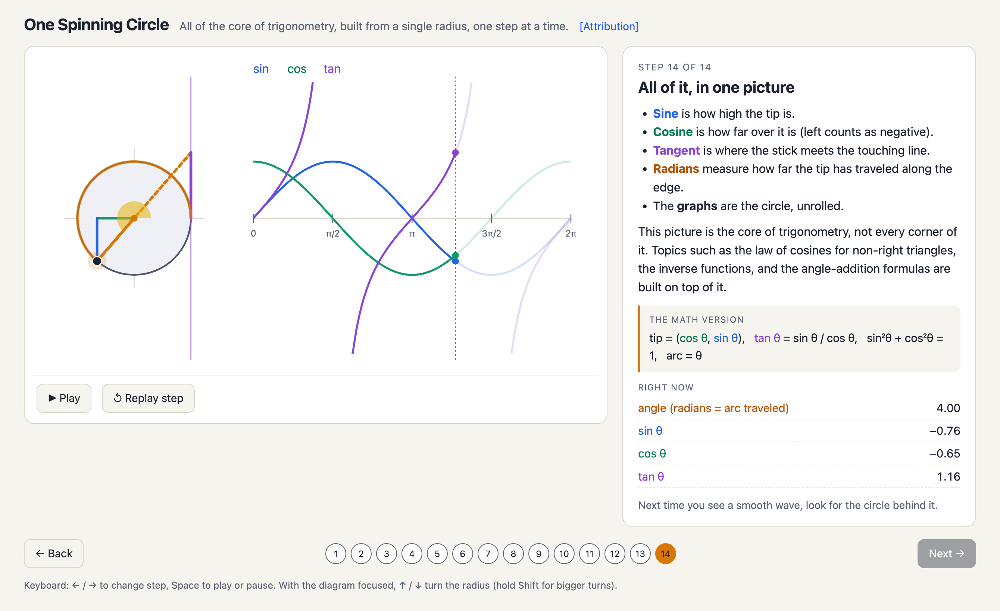
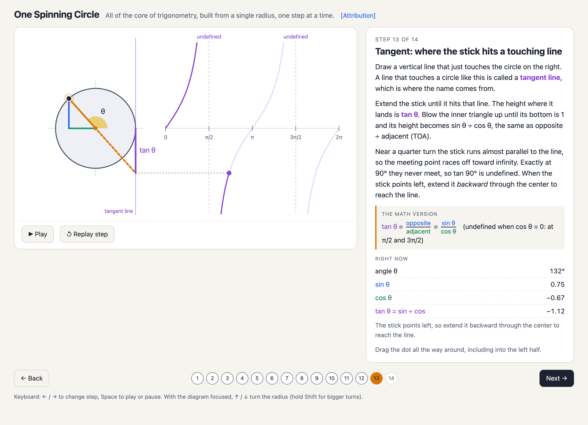

# One Spinning Circle

An interactive, step-by-step explainer showing that the core of trigonometry (sine, cosine, tangent, SOH CAH TOA, the Pythagorean identity, radians, and the trig graphs) all come from one radius spinning inside a unit circle. Each step explains one idea in plain language, shows the formula underneath, and animates it.

**Live demo:** [jftuga.github.io/one-spinning-circle](https://jftuga.github.io/one-spinning-circle/)

Inspired by the video [All of Trigonometry Is One Spinning Circle](https://www.youtube.com/watch?v=wgNLxPpWz5M) by Lemma. The concepts follow the video's teaching order. The visuals, wording, and code are original.

## Disclaimer

This project was written entirely by an AI model (Claude Opus 5.5, high effort setting), with the author directing the work but not writing the code or explanations by hand. The math and teaching content have been checked as described under [Verification performed](#verification-performed), but have not been reviewed by a mathematics educator. It may contain errors in calculations, explanations, or terminology. It is provided as is, under the MIT License, for informal learning only. Do not rely on it as an authoritative reference; confirm anything important against a textbook or a qualified instructor.

## Screenshots

Step 14 brings everything together: the spinning radius drives the sine, cosine, and tangent graphs at once.

Step 13 shows tangent as the height where the radius meets a vertical touching line. When the radius points left, it is extended backward through the center.

## Controls

To jump directly to a step, add `#step-N` to the URL, for example [`#step-8`](https://jftuga.github.io/one-spinning-circle/#step-8).

| Action | How |
|--------|-----|
| Next / previous step | `Next` and `Back` buttons, the numbered dots, or the Left / Right arrow keys |
| Change the angle | Drag the dot at the tip of the radius (on steps that show a draggable circle) |
| Change the angle by keyboard | Tab to the diagram, then Up / Down arrow keys turn the radius by 1°; hold Shift for 15° (same steps as dragging) |
| Play / pause the spin | `Play` button or the Space key (on steps that spin) |
| Restart a step's animation | `Replay step` button |
| Step-specific controls | Size slider (step 6), cosine slide button (step 10), angle buttons (step 11), amplitude / frequency / phase sliders (step 12) |

## The 14 steps

Show steps

| # | Title | Idea |
|---|-------|------|
| 1 | Three things... or one? | Three separate graphs all driven by the same spinning dot |
| 2 | Start with a length of 1 | A radius of 1 sweeps out the unit circle |
| 3 | Turn it by an angle | Defining the angle θ |
| 4 | Sine is how high, cosine is how far over | The definitions: tip = (cos θ, sin θ) |
| 5 | Below and left count as negative | Sine and cosine are signed positions, not lengths |
| 6 | Bigger triangles: SOH and CAH | Scaling the unit triangle gives opposite/hypotenuse and adjacent/hypotenuse |
| 7 | A free fact: sin² + cos² = 1 | Pythagoras on the unit triangle, with a bar showing the two areas always sum to 1 |
| 8 | A better ruler for angles: radians | Bending the radius around the edge; 1 rad ≈ 57.3°, π is a half turn |
| 9 | Unroll the edge: the sine wave | The edge laid flat as a tape (true length) traces the sine wave |
| 10 | Cosine is the same wave, a quarter turn ahead | Sliding cosine by π/2 lands it on sine |
| 11 | The "table of angles", explained | Deriving the 30°, 45°, and 60° values from the picture |
| 12 | Why waves are everywhere: three knobs | Amplitude, frequency, and phase, with period = 1/frequency |
| 13 | Tangent: where the stick hits a touching line | tan θ = sin θ / cos θ in all four quadrants, undefined at 90° and 270° |
| 14 | All of it, in one picture | The full composite, plus a note on what it does not cover |

## Departures from the source video

Show departures

In a few places the video is imprecise or leaves gaps. These are deliberately handled differently here:

- **Signed values (step 5):** The video calls cosine a "distance" even though it goes negative. Here, sine and cosine are presented as signed coordinates.
- **Special angles (step 11):** The video mentions a "table of angles" but never explains it. Here, the values are derived using equilateral triangles for 30° and 60°, and Pythagoras for 45°.
- **Three knobs, not two (step 12):** The video lists amplitude and frequency as "the two knobs" right after showing a phase shift. Here, phase is the third control, and the bracket the video labels "frequency" is labeled as the period.
- **Scoped real-world claim (step 12):** The video says "anything that swings back and forth" follows a sine wave. Here, the claim is limited to smooth, steady oscillations, with a note that complex signals are sums of sine waves.
- **Tangent in every quadrant (step 13):** The video's construction only works in the first quadrant. Here, the radius is extended backward through the center when it points left, and the undefined values are marked.
- **Scope (step 14):** The video claims "all of trigonometry". Here, the closing step names topics the picture does not directly cover: the law of cosines, inverse functions, and angle-addition formulas.

## Technical notes

Show technical notes

- Vanilla JavaScript and inline SVG only; no libraries, CDNs, or network requests.
- Each frame is redrawn from a small state object (angle, slider values, animation progress). Every step defines its own `draw` and `readout` functions in the `STEPS` array.
- Light and dark themes follow the operating system's `prefers-color-scheme` setting.
- When `prefers-reduced-motion` is set, intro animations are skipped and automatic spinning is off.
- Layout stacks into a single column below 920px width.
- Color code used throughout: orange = radius, blue = sine, green = cosine, purple = tangent, gold = angle.

## Verification performed

Show verification details

- Every step's draw and readout functions were run headlessly in Node across 13 angles (including exactly 90° and all four quadrants), 8 animation progress points, and varied slider values: 4,368 renders, with no exceptions and no `NaN`, `Infinity`, or `undefined` values in the SVG output.
- Every step was screenshotted in headless Chrome in light mode, and step 13 also in dark mode. The finished states were checked using a test copy that skips the intro animations.
- A layout probe in headless Chrome rendered every step at angles 0.05 rad apart around the full circle, through the intro animations, and with 9 combinations of slider, playback, and cosine-slide settings. It found no SVG text clipped at the edges or overlapping other text.
- Keyboard shortcuts were tested in headless Chrome with scripted key presses:
  - Left / Right change the step, and stop at the last step.
  - With Alt, Ctrl, or Cmd held, Left / Right are left to the browser.
  - Space plays and pauses only on steps that have a Play button.
  - Up / Down turn the radius, respect each step's angle limits, and pause the spin.
- The diagram's screen-reader slider attributes (role, range, and current angle) were checked on steps with and without a draggable radius.

